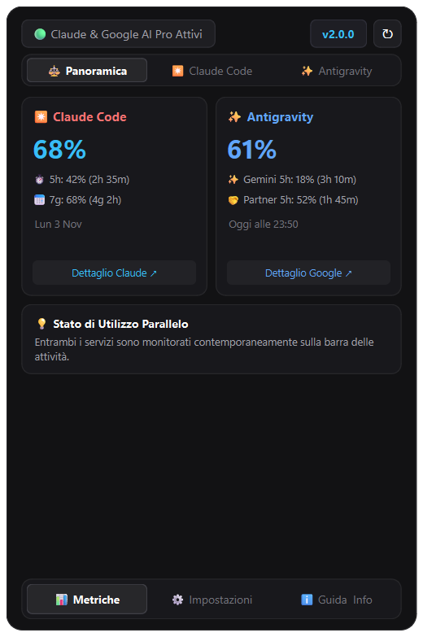
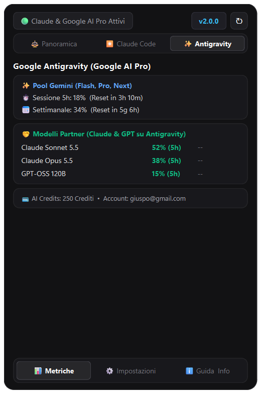
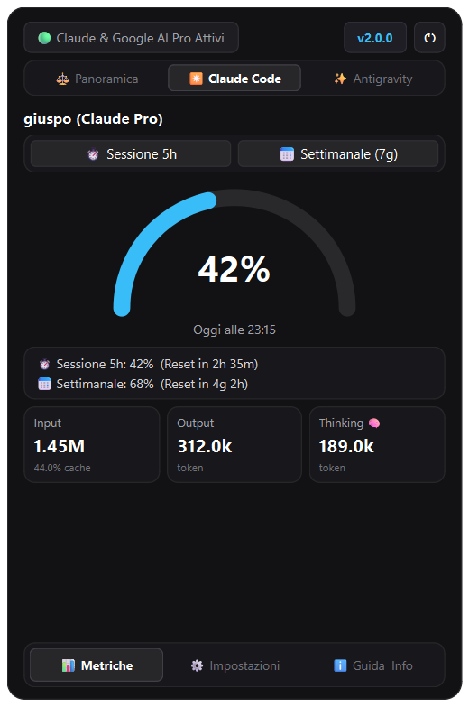
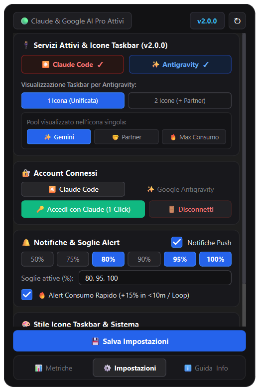
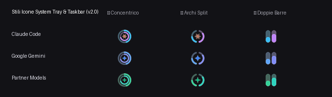

# Claude & Google Antigravity Usage Widget ⚡

<div align="center">


**The Ultimate Dual-Engine AI Quota & Rate-Limit Monitor for your System Tray.**

*Monitor Anthropic Claude Code and Google Antigravity (Google AI Pro) live quotas side-by-side without interrupting your terminal workflow or leaving your IDE.*

[Download Installer (v2.0.0)](https://github.com/giuspo/AnthropicUsage/releases) • [Features](#-key-features) • [Installation](#-installation--setup) • [Architecture](#-architecture--privacy) • [License](#-license--credits)

</div>

---

## 📸 Visual Showcase

<div align="center">

| ⚖️ Dual-Engine Overview | ✨ Google Antigravity & Partner Models |
| :---: | :---: |
|  |  |
| *Real-time dual-engine comparison: Claude 5h/7d vs. Google Antigravity.* | *Granular breakdown for Gemini Pool + all Partner models (Sonnet, Opus, GPT).* |

| ✴️ Claude Code & Thinking Tokens | ⚙️ Responsive Anti-Clipping Settings |
| :---: | :---: |
|  |  |
| *Semi-circular radial gauge, 5h/7d selector, and Thinking token metrics.* | *Fluent scroll area, interactive service cards, and 1-Click OAuth login.* |

</div>

### 🎨 Dynamic Taskbar & System Tray Icons

The widget renders pixel-perfect, 4x supersampled vector icons directly on your taskbar with dynamic status colors (Neutral `< 75%`, Warning Amber `75%–90%`, Critical Coral `> 90%`):

<div align="center">



</div>

*Choose between **Concentric Rings**, **Split Arcs (5h Left / 7d Right)**, or **Dual Bar Columns** with dedicated branded glyphs.*

---

## 🌟 Why Developers Love It

Tired of suddenly hitting your 5-hour quota limit in the middle of a complex coding turn? Need to balance your workloads between **Claude Code** and **Google Antigravity / Google AI Pro**?

* **⚡ Zero Context Switching**: Never interrupt your focus to check quota dashboards or type status commands. One glance at your taskbar gives you exact utilization and countdown to reset.
* **🤝 True Multi-Provider Intelligence**: Monitor **Anthropic Claude Code** and **Google Antigravity** concurrently, or toggle either service off with a single click.
* **💎 Granular Partner Models Breakdown**: Antigravity isn't just Gemini. View dedicated, real-time percentages for **Claude Sonnet 3.5/5.5**, **Claude Opus**, and **GPT-OSS** models hosted on Google infrastructure.
* **🎯 1, 2, or 3 Twin Tray Icons**: 
  - *Single Unified Icon*: Pick whether to display Gemini Pool, Partner Pool, or Max Consumption.
  - *Dual Antigravity Icons (3rd Taskbar Icon)*: Display separate dedicated icons for Gemini (Google Azure `#4285F4`) and Partner Models (Emerald `#10B981`).
* **🧠 Deep Thinking & Token Metrics**: Tracks Input, Output, and **Extended Thinking tokens** plus cache-hit percentages extracted directly from session transcripts.
* **🚨 Smart Alerts & Burn Rate Guard**: Detects rapid token consumption spikes (`+15% in < 10m` during loops) and sends native OS toast notifications at your chosen thresholds (50%, 75%, 80%, 90%, 95%, 100%) with smart anti-spam hysteresis.
* **🔒 100% Local & Zero-Config OAuth**: Direct integration with Windows Credential Manager and GNOME Secret Service. No API proxies, no telemetry, no credentials ever leaving your machine.

---

## 🎛️ Key Configuration Options

| Option | Description |
| :--- | :--- |
| **Active Services** | Toggle `✴️ Claude Code` and `✨ Google Antigravity` independently. |
| **Antigravity Tray Mode** | Choose between `1 Icon (Unified)` or `2 Icons (Gemini + 3rd Partner Icon)`. |
| **Unified Pool Selector** | When using 1 icon for Antigravity, select: `Gemini Pool`, `Partner Models`, or `🔥 Max Consumption`. |
| **1-Click Authentication** | Automatic zero-config detection from `gemini:antigravity` and `claude auth`, or 1-click browser OAuth login. |
| **Tray Icon Styles** | Switch instantly between **⭕ Concentric Rings**, **🌗 Split Arcs**, or **📊 Dual Bars**. |
| **Threshold Alerts** | Interactive pill chips for `50%`, `75%`, `80%`, `90%`, `95%`, `100%`, plus custom comma-separated percentages. |
| **Fast Burn Alert** | Proactive warning if an agent gets trapped in an automated loop consuming `>15%` within minutes. |
| **System Autostart** | 1-click Windows Registry autostart (`HKCU\...\Run`) and Linux XDG autostart. |
| **Simulation Mode (Mock)** | Test all themes, gauge states, and alerts without spending quota. |

---

## 🚀 Installation & Setup

### Method 1: Standard Windows Setup Wizard (Recommended)

1. Download **[`ClaudeUsageWidget-Setup-v2.0.0.exe`](https://github.com/giuspo/AnthropicUsage/releases)**.
2. Run the wizard (available in English & Italian).
3. Select optional Desktop shortcut and Startup integration.
4. The widget integrates with Windows Settings (*Installed Apps*), Start Menu, and System Tray.
5. In-place upgrade seamlessly preserves your existing configuration and tokens.

### Method 2: Portable Standalone Executable (Zero Install)

1. Download **[`ClaudeUsageWidget-v2.0.0-Windows.zip`](https://github.com/giuspo/AnthropicUsage/releases)** or **`ClaudeUsageWidget.exe`**.
2. Extract anywhere (e.g. USB flash drive or portable tools folder).
3. Double-click to launch directly into the system tray.

---

## 💻 Developer Quickstart (Python + uv)

### Prerequisites
* **Python 3.10+** (Python 3.14 fully supported)
* [**`uv`**](https://github.com/astral-sh/uv) (fast package manager) or standard `pip`

### Run from Source

```bash
# Clone the repository
git clone https://github.com/giuspo/AnthropicUsage.git
cd AnthropicUsage

# Install dependencies and sync virtual environment
uv sync

# Launch the widget
uv run python main.py

# Or launch with realistic demo simulation
uv run python main.py --mock
```

### Run the Test Suite

```bash
uv run pytest -v
# Output: 26 passed in ~0.95s
```

### Build Windows Binaries Locally

```bash
uv run python packaging/build_windows.py
# Generates PyInstaller standalone exe, Inno Setup wizard, and release zip in dist/
```

---

## 🏗️ Architecture & Privacy

```
AnthropicUsage/
├── src/claude_usage/
│   ├── main.py                     # Application lifecycle, Single-Instance Named Mutex
│   ├── config.py                   # Multi-provider settings & secure credentials
│   ├── core/
│   │   ├── models.py               # UsageSnapshot, AntigravityUsageSnapshot, CompositeUsageSnapshot
│   │   ├── engine.py               # UsageFusionEngine: concurrent polling & dual filewatchers
│   │   ├── antigravity_auth.py     # Native Credential Manager token discovery & auto-refresh
│   │   ├── antigravity_client.py   # CloudCode PA API client (Gemini + Partner models)
│   │   ├── antigravity_parser.py   # Local transcript scanner (~/.gemini/antigravity/brain/)
│   │   ├── auth_manager.py         # Claude Code OAuth discovery & refresh
│   │   ├── api_client.py           # Anthropic API client (/api/oauth/usage)
│   │   ├── jsonl_parser.py         # Local transcript token parser (~/.claude/projects/)
│   │   └── notifier.py             # DesktopNotifier with anti-spam hysteresis & burn detector
│   └── ui/
│       ├── theme.py                # Color palettes (Claude, Gemini Azure, Partner Emerald)
│       ├── icon_renderer.py        # 4x supersampled Pillow vector engine
│       ├── tray.py                 # TrayCoordinator managing 1, 2, or 3 dynamic tray icons
│       ├── flyout.py               # Borderless micro-flyout (Overview, Claude, Antigravity, Settings)
│       └── positioner.py           # Multi-monitor DPI-aware taskbar anchoring
├── docs/images/                    # High-resolution screenshots & UI showcase
└── tests/                          # 26 automated unit & integration tests
```

### 🔐 Security & Privacy First
* **Direct Official Endpoints**: All API communication connects directly via encrypted TLS to official endpoints (`api.anthropic.com` and `cloudcode-pa.googleapis.com`).
* **Zero Middlemen**: No third-party proxy servers, analytics, or external telemetry of any kind.
* **Native Keychain Encryption**: Tokens are stored and read securely using OS-native credential storage (Windows Credential Manager / Linux Secret Service).

---

## 📄 License & Credits

Created and maintained with ❤️ by **[giuspo](https://github.com/giuspo)** 🚀.

This project is licensed under the **GNU General Public License v3.0 (GPLv3)**.  
See the [`LICENSE`](LICENSE) file for details.

*Strong Copyleft: You are free to run, study, share, and modify this software, provided all derivative works remain open source under the same license terms.*
